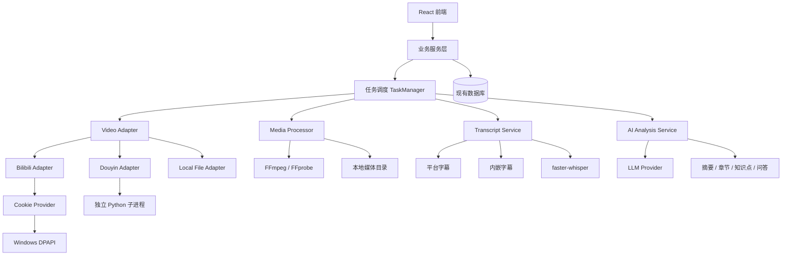

# VidLearn AI · Development Plan V2.0

> Development Plan · Version 2.0 · 2026-11-02
> 状态：**决策已冻结** · Windows First · 工程估算 41–56 人日（预算按 66 人日预留）
> 配套：`PRD_V2.0.md`、`Architecture_Decisions_V2.0.md`、`PoC_Acceptance_Criteria_V2.0.md`

## 1. 开发目标

按照 PRD V2.0 完成 Windows 本地视频学习系统。

开发原则：

1. 先验证关键技术，再进行正式开发。
2. 先完成媒体处理链路，再完成 AI 分析。
3. 优先保证主流程闭环，而不是先堆叠高级功能。
4. 保留现有前端原型和核心数据结构。
5. 各模块通过接口解耦，方便多 Agent 并行开发。

## 2. 总体技术架构

数据库沿用项目现有技术栈，不在没有必要的情况下引入新的数据库系统。

## 3. 开发阶段 S0–S8

### S0：技术验证（前置门禁）

| 任务 | 内容 | 验收标准 |
|--------|--------|--------|
| S0-01 | B站 Cookie 登录 PoC | Cookie 导入、1080P 下载验证 |
| S0-02 | B站平台字幕 PoC | 验证人工字幕及 AI 字幕 |
| S0-03 | 抖音下载 PoC | 短链、长链、实际下载、匿名能力 |
| S0-04 | ASR PoC | 长视频分段、识别、合并 |
| S0-05 | 媒体完整性 PoC | FFprobe 与实际播放验证 |

**S0 输出：** 技术验证报告、依赖版本清单、接口约定和已知风险清单。详见 `PoC_Acceptance_Criteria_V2.0.md`。

### S1：基础设施和凭证管理（预计 6–7 人日）

| 任务 | 内容 | DoD |
|--------|--------|--------|
| S1-01 | Windows 开发环境 | Python 3.12、uv、FFmpeg 可运行 |
| S1-02 | 配置管理 | 配置可读取、可校验 |
| S1-03 | CredentialProvider | 统一凭证管理接口 |
| S1-04 | DPAPI 加密 | Cookie 加密保存和解密使用 |
| S1-05 | Cookie 导入 | 支持手动粘贴、格式转换 |
| S1-06 | 日志脱敏 | Cookie 不进入日志 |
| S1-07 | TaskManager | 支持任务创建、状态和异常 |
| S1-08 | 媒体目录 | 统一文件存储路径 |

### S2：视频来源适配器（预计 7–9 人日）

| 任务 | 内容 | DoD |
|--------|--------|--------|
| S2-01 | VideoAdapter | 统一来源接口 |
| S2-02 | LocalFileAdapter | 本地文件导入 |
| S2-03 | B站匿名模式 | 匿名视频下载 |
| S2-04 | B站登录模式 | Cookie 登录下载 |
| S2-05 | B站字幕获取 | 平台字幕提取 |
| S2-06 | DouyinAdapter | 抖音统一适配器 |
| S2-07 | Python 子进程 | 调用抖音下载器 |
| S2-08 | 下载管理 | 下载进度、失败、重试 |
| S2-09 | 错误分类 | 登录失效、网络、权限、格式变更 |

### S3：媒体资产和字幕处理（预计 5–7 人日）

| 任务 | 内容 | DoD |
|--------|--------|--------|
| S3-01 | MediaAsset | 媒体资产模型 |
| S3-02 | FFprobe | 视频信息提取 |
| S3-03 | 完整性检查 | 多指标校验 |
| S3-04 | 内嵌字幕提取 | 支持 SubRip 等格式 |
| S3-05 | 用户字幕导入 | 支持外部字幕 |
| S3-06 | 平台字幕标准化 | 时间戳统一为毫秒 |
| S3-07 | Transcript 模型 | 标准化分段模型 |
| S3-08 | 字幕覆盖率 | 识别字幕质量和完整性 |
| S3-09 | 状态管理 | 处理状态正确流转 |

### S4：本地 ASR（预计 3–5 人日）

| 任务 | 内容 | DoD |
|--------|--------|--------|
| S4-01 | FFmpeg 音频提取 | 16kHz 单声道 PCM |
| S4-02 | ASRProvider | 统一识别接口 |
| S4-03 | faster-whisper | 本地 CPU int8 模式 |
| S4-04 | 长音频切片 | 分段识别 |
| S4-05 | 结果合并 | 时间戳连续、分段合理 |
| S4-06 | 识别完整性 | 记录失败和质量状态 |
| S4-07 | 云端 ASR 接口 | 预留可选扩展 |

### S5：AI 内容分析（预计 6–7 人日）

| 任务 | 内容 | DoD |
|--------|--------|--------|
| S5-01 | LLM Provider | 统一模型调用接口 |
| S5-02 | Transcript Context Builder | 构建字幕上下文 |
| S5-03 | 视频摘要 | 输出结构化摘要 |
| S5-04 | 章节生成 | 章节带时间戳 |
| S5-05 | 知识点提取 | 输出知识点及关联时间 |
| S5-06 | 视频问答 | 基于视频字幕回答 |
| S5-07 | 数据持久化 | 分析结果可重复读取 |

**数据安全门禁：** 所有云端请求只能包含文本类内容，不能包含视频、音频和关键帧。

### S6：本地播放器与学习工作台（预计 5–8 人日）

| 任务 | 内容 | DoD |
|--------|--------|--------|
| S6-01 | 本地媒体访问 | 后端安全提供媒体访问 |
| S6-02 | HTTP Range | 支持视频分段读取 |
| S6-03 | 播放器 | 本地视频正常播放 |
| S6-04 | 编码兼容 | H.264 优先 |
| S6-05 | 字幕同步 | 时间戳准确 |
| S6-06 | 章节跳转 | 点击章节定位视频 |
| S6-07 | 工作台整合 | 接入现有原型 |

非 H.264 视频优先尝试原生播放，必要时再考虑转码，不默认转码所有视频。

### S7：视频库和业务闭环（预计 5–7 人日）

| 任务 | 内容 | DoD |
|--------|--------|--------|
| S7-01 | 导入 UI | 支持链接和文件 |
| S7-02 | 视频 Gallery | 列表和状态展示 |
| S7-03 | 视频详情 | 展示摘要及分析资料 |
| S7-04 | 学习进度 | 保存和恢复进度 |
| S7-05 | 笔记功能 | 笔记持久化 |
| S7-06 | 删除功能 | 按用户选择清理文件和资料 |
| S7-07 | 端到端测试 | 完成完整导入到学习流程 |

### S8：安全、稳定性与发布（预计 4–6 人日）

| 任务 | 内容 | DoD |
|--------|--------|--------|
| S8-01 | 凭证安全 | DPAPI、日志脱敏 |
| S8-02 | 子进程隔离 | 抖音服务异常不影响主程序 |
| S8-03 | 路径安全 | 防止非法文件访问 |
| S8-04 | 任务恢复 | 异常退出后可恢复 |
| S8-05 | 长视频压力测试 | 验证资源和处理稳定性 |
| S8-06 | 许可证检查 | 记录第三方依赖许可证 |
| S8-07 | Windows 打包 | 可部署、可启动 |

## 4. 工作量估算

| 阶段 | 预计人日 |
|--------|--------|
| S1 | 6–7 |
| S2 | 7–9 |
| S3 | 5–7 |
| S4 | 3–5 |
| S5 | 6–7 |
| S6 | 5–8 |
| S7 | 5–7 |
| S8 | 4–6 |
| **合计** | **41–56** |

建议项目预算按 **41–66 人日** 预留，额外空间用于抖音兼容性、平台接口变化、依赖冲突及 Windows 环境问题。

这属于工程人日估算，不等于日历工期；实际工期取决于 Agent 并行效率、代码基础和集成返工情况。

## 5. 多 Agent 开发组织

建议以 DeepSeek Harness 为调度平台，内置编码 Agent 为执行器，本地项目目录为唯一代码工作区。

| Agent | 主要职责 |
|--------|--------|
| Product Agent | PRD、需求和验收标准 |
| Architect Agent | 架构、接口和数据模型 |
| Backend Agent | 下载、任务、媒体处理 |
| ASR Agent | 字幕和本地语音识别 |
| AI Agent | LLM、摘要、知识点、问答 |
| Frontend Agent | Gallery、播放器、学习工作台 |
| QA Agent | 测试、回归和验收 |
| Integrator Agent | 分支合并、集成和发布 |

**并行开发规则：**

- 每个 Agent 只负责明确划分的模块。
- 公共接口由 Architect Agent 先行定义。
- 数据库结构变更需要统一评审。
- 不允许多个 Agent 同时修改同一个核心文件。
- 每个任务必须提供代码、测试和验收结果。
- Integrator Agent 负责最终集成，不以「代码已生成」作为任务完成标准。

## 6. 关键风险和控制

| 风险 | 处理策略 |
|--------|--------|
| B站 Cookie 失效 | 提供失效提示和重新导入 |
| B站接口变化 | Adapter 隔离，方便替换 |
| 抖音下载器失效 | S0 PoC、独立进程、保留本地导入 |
| ASR 长视频资源占用 | 切片处理、资源监控 |
| 媒体文件不完整 | 多指标校验 |
| 字幕质量不佳 | 记录来源、质量状态 |
| LLM 输出不稳定 | 结构化输出和校验 |
| 视频编码不兼容 | 原生播放优先，转码兜底 |
| 凭证泄露 | DPAPI、日志脱敏、最小权限 |
| 平台合规风险 | 遵守平台规则及视频权利人授权要求 |
