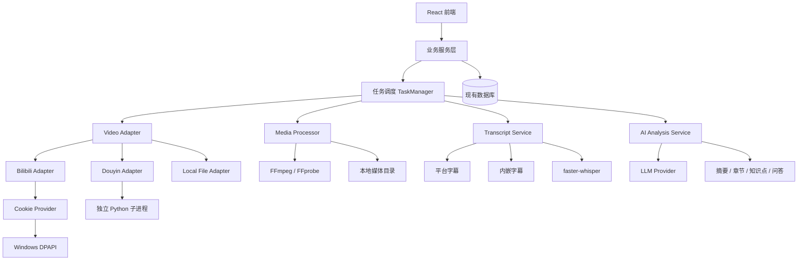

# VidLearn AI — 正式版本 V2.0

(决策已冻结) (Windows First) (V2.0)

## 一、冻结决策清单

以下 D01–D05 作为 V2.0 的正式技术决策，后续开发不得擅自改变。

| 编号 | 决策 | 冻结方案 |
|--------|--------|--------|
| D01 | Cookie 加密 | Windows DPAPI |
| D02 | B站登录 | 用户手动粘贴 Cookie，系统负责格式转换、加密和管理 |
| D03 | 抖音下载 | `jiji262/douyin-downloader`，独立 Python 子进程 |
| D04 | 抖音 Cookie | 不预设必须登录，先验证匿名下载能力 |
| D05 | 抖音 PoC | 正式开发前必须完成技术验证 |

其他已确认的产品决策：

| 项目 | 冻结方案 |
|--------|--------|
| ASR | 本地 faster-whisper 默认 |
| 视频保留 | 永久保留，用户手动删除 |
| 首发平台 | Windows |
| 云端 AI | 仅上传字幕、文本，不上传视频、音频和关键帧 |
| B站清晰度 | 登录态优先，争取 1080P；匿名模式按 720P 设计 |
| 字幕优先级 | 平台字幕 → 内嵌字幕 → 本地 ASR |
| 视频处理 | 下载到本地后处理、本地播放 |
| 原型与核心功能 | 保留现有原型和核心学习工作台 |

---

# 文档一：VidLearn AI PRD V2.0

Product Requirements Document · Version 2.0 · 2026-11-02

## 1. 产品概述

### 1.1 产品定位

VidLearn AI 是一个面向视频学习场景的 AI 视频理解与知识管理工具。

用户输入在线视频地址或导入本地视频，系统自动完成视频获取、字幕提取、语音识别、AI 内容理解和知识整理，最终将视频转换为可播放、可检索、可交互的学习资料。

产品核心理念：

**不只是总结视频，而是将视频转化为可持续使用的知识资产。**

### 1.2 核心用户价值

1. 不必完整观看长视频，也能快速掌握核心内容。
2. 能够按照章节和知识点定位视频原始位置。
3. 可以围绕视频内容与 AI 进行问答。
4. 可以保存笔记、学习进度和重要知识点。
5. 视频及其知识资料保存在本地，形成个人视频知识库。

### 1.3 产品目标

V2.0 的目标是建立一个完整、可运行的 Windows 本地视频学习系统。

重点解决四个问题：

- 视频能否稳定获取。
- 字幕能否可靠获取。
- AI 能否准确理解视频内容。
- 用户能否围绕视频完成学习和知识沉淀。

## 2. 用户使用流程

## 核心业务流程

1. **导入视频**
   
   支持 Bilibili、抖音和本地视频文件。
2. **下载与媒体校验**
   
   获取视频文件，检查文件完整性、编码和可播放性。
3. **字幕获取**
   
   优先使用平台字幕，其次提取内嵌字幕，最后使用本地 ASR。
4. **AI 内容分析**
   
   生成摘要、章节、知识点、关键时间戳。
5. **保存学习资料**
   
   保存视频、字幕、分析结果及用户笔记。
6. **进入学习工作台**
   
   播放视频、同步字幕、跳转章节、AI 问答和记录学习进度。

## 3. 功能需求

### 3.1 视频导入模块

| 功能 | 需求说明 | 优先级 |
|--------|--------|--------|
| B站链接导入 | 支持匿名和登录态下载 | P0 |
| B站 Cookie 导入 | 手动粘贴 Cookie | P0 |
| B站视频下载 | 登录态优先获取 1080P，匿名模式按 720P 处理 | P0 |
| B站字幕 | 获取平台人工字幕及 AI 字幕 | P0 |
| 抖音链接导入 | 通过独立下载器处理 | P0 |
| 本地视频导入 | 支持选择本地视频文件 | P0 |
| 批量导入 | 支持多视频任务 | P1 |
| 重复检测 | 根据来源标识及文件信息去重 | P1 |

说明：平台提供的清晰度和字幕能力可能受账号权限、视频版权、地区、平台接口变化等因素影响，不能保证每条视频都能获取到 1080P 或平台字幕。

### 3.2 凭证管理模块

**B站 Cookie 管理**

- 用户手动粘贴 Cookie。
- 系统转换为下载工具所需格式。
- 使用 Windows DPAPI 加密保存。
- 不在普通日志中输出 Cookie。
- 支持更新、清除和失效检测。
- Cookie 不进入代码仓库和普通临时文件。

**安全要求**

- 凭证只用于本地下载流程。
- 不向 AI 服务提供 Cookie。
- 不向外部服务传输凭证。
- 不在异常堆栈和调试日志中暴露凭证。

### 3.3 抖音下载模块

采用 `jiji262/douyin-downloader` 作为首选技术方案。

架构要求：

- 独立 Python 子进程。
- 与主业务进程隔离。
- 使用统一的 DouyinAdapter 接口。
- 主程序通过标准输入输出或约定的进程通信协议获取结果。
- 下载失败时返回明确错误码。
- 支持后续替换其他下载实现。

D05 PoC 验证内容：

1. 短链接解析。
2. 长链接解析。
3. 视频元数据获取。
4. 实际视频下载。
5. FFprobe 文件验证。
6. 匿名模式测试。
7. Cookie 必要性测试。
8. 项目依赖、许可证和运行稳定性检查。

(上线门禁) PoC 不通过，不得将抖音下载能力标记为正式可用。

### 3.4 字幕处理模块

字幕获取优先级：

| 顺序 | 字幕来源 | 说明 |
|--------|--------|--------|
| 1 | 平台字幕 | B站登录态平台字幕优先 |
| 2 | 内嵌字幕 | 从视频文件中提取 |
| 3 | 本地 ASR | faster-whisper |
| 4 | 云端 ASR | 可选扩展，不作为默认流程 |

字幕数据必须保留：

- 字幕内容。
- 开始时间。
- 结束时间。
- 语言。
- 字幕来源。
- 字幕质量或状态。

平台字幕需要区分人工字幕和 AI 字幕，不得将两者混为同一来源。

### 3.5 本地 ASR 模块

默认采用 faster-whisper。

处理流程：

```text
视频文件
   ↓
FFmpeg 提取音频
   ↓
16kHz 单声道 PCM
   ↓
faster-whisper
   ↓
字幕分段
   ↓
时间戳归一化
   ↓
保存 transcript_segments
```

关键技术约束：

- 不使用 PyAV 作为音频处理的核心路径。
- 使用 FFmpeg 完成音频提取。
- ASR 默认采用本地模型。
- 支持长视频分段处理。
- 支持分段结果合并。
- 记录模型、语言和识别状态。

### 3.6 AI 视频分析模块

输入数据为字幕文本及必要的时间戳信息。

输出内容：

| 功能 | 说明 |
|--------|--------|
| 视频摘要 | 提炼核心内容 |
| 章节划分 | 按内容逻辑生成章节 |
| 知识点提取 | 提取重要概念和结论 |
| 关键时间戳 | 关联原始视频位置 |
| 视频问答 | 基于字幕和分析结果回答 |
| 知识整理 | 形成可持续保存的学习资料 |

云端 AI 数据边界：

(已冻结) 仅上传文本类数据。

禁止上传：

- 原始视频。
- 原始音频。
- 视频关键帧。
- 未经用户授权的其他媒体内容。

### 3.7 视频学习工作台

保留既有原型中的核心交互能力：

- 视频播放器。
- 字幕同步。
- 章节目录。
- 章节跳转。
- AI 摘要。
- 知识点展示。
- AI 问答。
- 学习笔记。
- 学习进度。
- 历史学习记录。

### 3.8 视频库

视频库作为用户的长期知识资产入口。

主要功能：

- 视频列表。
- 视频详情。
- 视频封面。
- 来源信息。
- 处理状态。
- 学习进度。
- 搜索和筛选。
- 删除视频。

视频默认永久保留，只有用户主动删除时才执行清理。

删除操作需要明确区分：

1. 删除学习资料。
2. 删除视频文件。
3. 同时删除视频及其关联资料。

具体交互和关联清理策略在 S7 阶段冻结。

## 4. 数据模型要求

V2.0 继续保留现有核心数据模型：

| 数据模型 | 职责 |
|--------|--------|
| `media_assets` | 视频媒体资产及文件信息 |
| `source_captions` | 原始字幕来源及内容 |
| `transcript_segments` | 标准化字幕分段 |

媒体完整性状态至少支持：

- `verified`
- `likely`
- `partial`
- `unknown`

任务状态：

```text
CREATED
   ↓
MEDIA_PROCESSING
   ↓
MEDIA_READY
   ↓
TRANSCRIPT_PROCESSING
   ↓
TRANSCRIPT_READY
   ↓
AI_ANALYZING
   ↓
COMPLETED / FAILED
```

不得因为某一个 FFprobe 指标异常，就简单认定文件一定不可用；需要结合文件大小、容器解析、时长、音视频流和实际播放验证。

## 5. 非功能需求

| 维度 | 要求 |
|--------|--------|
| 操作系统 | Windows 优先 |
| 本地运行 | 视频处理和 ASR 在本地执行 |
| 媒体处理 | FFmpeg / FFprobe |
| 视频编码 | 优先兼容 H.264 |
| 长视频 | 支持分段处理和任务恢复 |
| 安全 | Cookie 加密、日志脱敏 |
| 稳定性 | 下载失败、识别失败、AI 失败可独立恢复 |
| 数据持久化 | 视频长期保留 |
| 可扩展性 | 下载器、ASR、LLM 使用 Provider/Adapter 抽象 |

## 6. 验收标准

| 模块 | 验收条件 |
|--------|--------|
| B站匿名 | 能下载符合权限范围的视频 |
| B站登录 | 手动 Cookie 可导入、加密和使用 |
| B站字幕 | 能获取可用的平台字幕；缺失时进入后续流程 |
| 抖音 | PoC 通过后，完成真实视频下载和媒体校验 |
| 本地导入 | 可导入本地视频并进入处理流程 |
| 字幕 | 能正确提取、识别、保存和同步 |
| AI 分析 | 能生成摘要、章节、知识点 |
| 播放器 | 支持本地视频播放和时间戳跳转 |
| 知识库 | 可保存、检索和再次打开学习资料 |
| 安全 | Cookie 不明文存储、不输出到日志 |
| 长期存储 | 重启后视频和学习资料仍然存在 |

---

# 文档二：VidLearn AI Development Plan V2.0

Development Plan · Version 2.0 · 2026-11-02

## 1. 开发目标

按照 PRD V2.0 完成 Windows 本地视频学习系统。

开发原则：

1. 先验证关键技术，再进行正式开发。
2. 先完成媒体处理链路，再完成 AI 分析。
3. 优先保证主流程闭环，而不是先堆叠高级功能。
4. 保留现有前端原型和核心数据结构。
5. 各模块通过接口解耦，方便多 Agent 并行开发。

## 2. 总体技术架构



数据库沿用项目现有技术栈，不在没有必要的情况下引入新的数据库系统。

## 3. 开发阶段 S0–S8

### S0：技术验证

(前置门禁)

| 任务 | 内容 | 验收标准 |
|--------|--------|--------|
| S0-01 | B站 Cookie 登录 PoC | Cookie 导入、1080P 下载验证 |
| S0-02 | B站平台字幕 PoC | 验证人工字幕及 AI 字幕 |
| S0-03 | 抖音下载 PoC | 短链、长链、实际下载、匿名能力 |
| S0-04 | ASR PoC | 长视频分段、识别、合并 |
| S0-05 | 媒体完整性 PoC | FFprobe 与实际播放验证 |

**S0 输出：** 技术验证报告、依赖版本清单、接口约定和已知风险清单。

### S1：基础设施和凭证管理

预计 6–7 人日

| 任务 | 内容 | DoD |
|--------|--------|--------|
| S1-01 | Windows 开发环境 | Python 3.12、uv、FFmpeg 可运行 |
| S1-02 | 配置管理 | 配置可读取、可校验 |
| S1-03 | CredentialProvider | 统一凭证管理接口 |
| S1-04 | DPAPI 加密 | Cookie 加密保存和解密使用 |
| S1-05 | Cookie 导入 | 支持手动粘贴、格式转换 |
| S1-06 | 日志脱敏 | Cookie 不进入日志 |
| S1-07 | TaskManager | 支持任务创建、状态和异常 |
| S1-08 | 媒体目录 | 统一文件存储路径 |

### S2：视频来源适配器

预计 7–9 人日

| 任务 | 内容 | DoD |
|--------|--------|--------|
| S2-01 | VideoAdapter | 统一来源接口 |
| S2-02 | LocalFileAdapter | 本地文件导入 |
| S2-03 | B站匿名模式 | 匿名视频下载 |
| S2-04 | B站登录模式 | Cookie 登录下载 |
| S2-05 | B站字幕获取 | 平台字幕提取 |
| S2-06 | DouyinAdapter | 抖音统一适配器 |
| S2-07 | Python 子进程 | 调用抖音下载器 |
| S2-08 | 下载管理 | 下载进度、失败、重试 |
| S2-09 | 错误分类 | 登录失效、网络、权限、格式变更 |

### S3：媒体资产和字幕处理

预计 5–7 人日

| 任务 | 内容 | DoD |
|--------|--------|--------|
| S3-01 | MediaAsset | 媒体资产模型 |
| S3-02 | FFprobe | 视频信息提取 |
| S3-03 | 完整性检查 | 多指标校验 |
| S3-04 | 内嵌字幕提取 | 支持 SubRip 等格式 |
| S3-05 | 用户字幕导入 | 支持外部字幕 |
| S3-06 | 平台字幕标准化 | 时间戳统一为毫秒 |
| S3-07 | Transcript 模型 | 标准化分段模型 |
| S3-08 | 字幕覆盖率 | 识别字幕质量和完整性 |
| S3-09 | 状态管理 | 处理状态正确流转 |

### S4：本地 ASR

预计 3–5 人日

| 任务 | 内容 | DoD |
|--------|--------|--------|
| S4-01 | FFmpeg 音频提取 | 16kHz 单声道 PCM |
| S4-02 | ASRProvider | 统一识别接口 |
| S4-03 | faster-whisper | 本地 CPU int8 模式 |
| S4-04 | 长音频切片 | 分段识别 |
| S4-05 | 结果合并 | 时间戳连续、分段合理 |
| S4-06 | 识别完整性 | 记录失败和质量状态 |
| S4-07 | 云端 ASR 接口 | 预留可选扩展 |

### S5：AI 内容分析

预计 6–7 人日

| 任务 | 内容 | DoD |
|--------|--------|--------|
| S5-01 | LLM Provider | 统一模型调用接口 |
| S5-02 | Transcript Context Builder | 构建字幕上下文 |
| S5-03 | 视频摘要 | 输出结构化摘要 |
| S5-04 | 章节生成 | 章节带时间戳 |
| S5-05 | 知识点提取 | 输出知识点及关联时间 |
| S5-06 | 视频问答 | 基于视频字幕回答 |
| S5-07 | 数据持久化 | 分析结果可重复读取 |

**数据安全门禁：** 所有云端请求只能包含文本类内容，不能包含视频、音频和关键帧。

### S6：本地播放器与学习工作台

预计 5–8 人日

| 任务 | 内容 | DoD |
|--------|--------|--------|
| S6-01 | 本地媒体访问 | 后端安全提供媒体访问 |
| S6-02 | HTTP Range | 支持视频分段读取 |
| S6-03 | 播放器 | 本地视频正常播放 |
| S6-04 | 编码兼容 | H.264 优先 |
| S6-05 | 字幕同步 | 时间戳准确 |
| S6-06 | 章节跳转 | 点击章节定位视频 |
| S6-07 | 工作台整合 | 接入现有原型 |

非 H.264 视频优先尝试原生播放，必要时再考虑转码，不默认转码所有视频。

### S7：视频库和业务闭环

预计 5–7 人日

| 任务 | 内容 | DoD |
|--------|--------|--------|
| S7-01 | 导入 UI | 支持链接和文件 |
| S7-02 | 视频 Gallery | 列表和状态展示 |
| S7-03 | 视频详情 | 展示摘要及分析资料 |
| S7-04 | 学习进度 | 保存和恢复进度 |
| S7-05 | 笔记功能 | 笔记持久化 |
| S7-06 | 删除功能 | 按用户选择清理文件和资料 |
| S7-07 | 端到端测试 | 完成完整导入到学习流程 |

### S8：安全、稳定性与发布

预计 4–6 人日

| 任务 | 内容 | DoD |
|--------|--------|--------|
| S8-01 | 凭证安全 | DPAPI、日志脱敏 |
| S8-02 | 子进程隔离 | 抖音服务异常不影响主程序 |
| S8-03 | 路径安全 | 防止非法文件访问 |
| S8-04 | 任务恢复 | 异常退出后可恢复 |
| S8-05 | 长视频压力测试 | 验证资源和处理稳定性 |
| S8-06 | 许可证检查 | 记录第三方依赖许可证 |
| S8-07 | Windows 打包 | 可部署、可启动 |

## 4. 工作量估算

| 阶段 | 预计人日 |
|--------|--------|
| S1 | 6–7 |
| S2 | 7–9 |
| S3 | 5–7 |
| S4 | 3–5 |
| S5 | 6–7 |
| S6 | 5–8 |
| S7 | 5–7 |
| S8 | 4–6 |
| **合计** | **41–56** |

建议项目预算按 **41–66 人日** 预留，额外空间用于抖音兼容性、平台接口变化、依赖冲突及 Windows 环境问题。

这属于工程人日估算，不等于日历工期；实际工期取决于 Agent 并行效率、代码基础和集成返工情况。

## 5. 多 Agent 开发组织

建议以 DeepSeek Harness 为调度平台，内置编码 Agent 为执行器，本地项目目录为唯一代码工作区。

| Agent | 主要职责 |
|--------|--------|
| Product Agent | PRD、需求和验收标准 |
| Architect Agent | 架构、接口和数据模型 |
| Backend Agent | 下载、任务、媒体处理 |
| ASR Agent | 字幕和本地语音识别 |
| AI Agent | LLM、摘要、知识点、问答 |
| Frontend Agent | Gallery、播放器、学习工作台 |
| QA Agent | 测试、回归和验收 |
| Integrator Agent | 分支合并、集成和发布 |

**并行开发规则：**

- 每个 Agent 只负责明确划分的模块。
- 公共接口由 Architect Agent 先行定义。
- 数据库结构变更需要统一评审。
- 不允许多个 Agent 同时修改同一个核心文件。
- 每个任务必须提供代码、测试和验收结果。
- Integrator Agent 负责最终集成，不以“代码已生成”作为任务完成标准。

## 6. 关键风险和控制

| 风险 | 处理策略 |
|--------|--------|
| B站 Cookie 失效 | 提供失效提示和重新导入 |
| B站接口变化 | Adapter 隔离，方便替换 |
| 抖音下载器失效 | S0 PoC、独立进程、保留本地导入 |
| ASR 长视频资源占用 | 切片处理、资源监控 |
| 媒体文件不完整 | 多指标校验 |
| 字幕质量不佳 | 记录来源、质量状态 |
| LLM 输出不稳定 | 结构化输出和校验 |
| 视频编码不兼容 | 原生播放优先，转码兜底 |
| 凭证泄露 | DPAPI、日志脱敏、最小权限 |
| 平台合规风险 | 遵守平台规则及视频权利人授权要求 |

---

# 三、正式冻结记录

**VidLearn AI V2.0 基线** (已确认)

---

**产品基线**

视频下载到本地 → 字幕获取 → 本地 ASR → AI 文本分析 → 本地学习工作台。

**技术决策**

D01–D05 全部冻结，Windows DPAPI、手动 Cookie、抖音独立 Python 子进程、匿名能力优先验证、PoC 先行。

**开发基线**

S0–S8，工程估算 41–56 人日，预算上限建议按 66 人日规划。

**数据边界**

本地保存视频及学习资料；云端 AI 仅接收文本。

## 四、建议的下一步执行顺序

我建议不要立即让多个 Agent 同时写代码，而是按照以下顺序推进：

1. 将 PRD V2.0 和 Development Plan V2.0 放入项目的 `docs/` 目录。
2. 让 Architect Agent 检查现有项目代码和数据库结构。
3. 先完成 S0 的三个核心 PoC：B站、抖音、ASR。
4. 根据 PoC 结果冻结接口和依赖版本。
5. 再启动 S1–S8 的多 Agent 开发。

建议文档文件名：

```text
docs/
├── PRD_V2.0.md
├── Development_Plan_V2.0.md
├── Architecture_Decisions_V2.0.md
└── PoC_Acceptance_Criteria_V2.0.md
```

**特别说明：** 上面已经交付两份正式文档正文，但尚未生成实际 Markdown 文件。后续生成文件时，应以这份正文为基线，而不是重新设计一套方案。

---